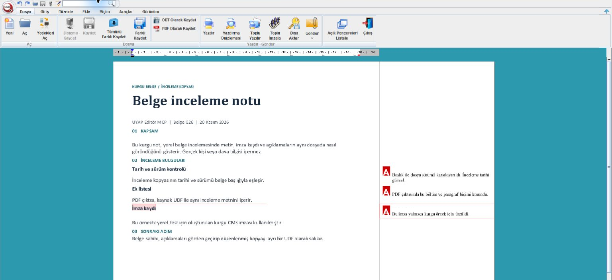
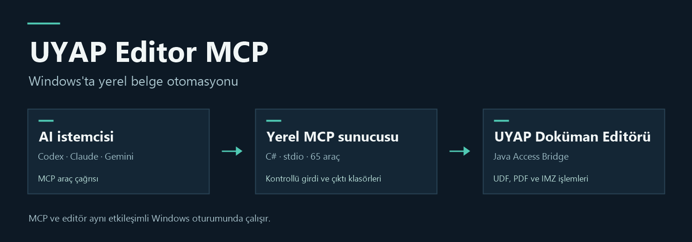
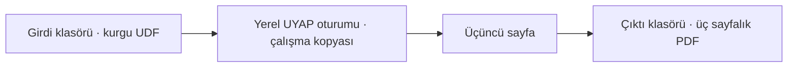

# UYAP Editor MCP

UYAP Doküman Editörü 5.4.20’yi **Windows x64’te yerel olarak** kullanan 65 araçlık bir MCP sunucusu. UDF açabilir, sayfalar arasında gezebilir, belgeyi düzenleyebilir ve editörün kendi menüleriyle çıktı alabilirsin. Codex ile belge akışı doğrulandı. Claude, Gemini CLI, Antigravity ve OpenCode için kurulum ve test durumu aşağıda yer alıyor.

Bu, bağımsız bir açık kaynak projesidir. UYAP Doküman Editörü’nü [Adalet Bakanlığının resmî sitesinden](https://uyap.gov.tr/uyap-editor/) ayrı kur.



*Gerçek UYAP penceresinde kurgu inceleme notu ve yorumları. IMZ dışa aktarma ayrı bir kurgu CMS imzalı UDF ile doğrulandı.*

Sunucu Windows’ta ayrı bir süreç olarak çalışır. İstemci araç çağrılarını ve sonuçlarını `stdio` üzerinden alır ve gönderir. Proje belge, kullanım verisi veya telemetri toplamaz. Belge metnini isteyen bir çağrı yaparsan seçtiğin AI istemcisi bu metni alır ve kendi veri politikasını uygular. [Gizlilik ve veri akışı](PRIVACY.md)

[Windows kurulumu](#windows-kurulumu) · [İlk deneme](#ilk-deneme) · [Kaldırma](#kaldırma) · [Test durumu](#test-durumu) · [MCP katalogları](#mcp-katalogları)

## Nasıl çalışır



İstemcide “UDF’yi aç, üçüncü sayfaya git ve bir PDF oluştur” diye yazarsın. İstemci sırayla `uyap_open`, `uyap_go_to_page` ve `uyap_export_pdf` araçlarını çağırır. Yerel MCP, Java köprüsüyle UYAP’ın belge motoruna ve menülerine erişir. İstemciye belge kimliğini, doğrulanan sayfayı, PDF yolunu ve çıktı özetini döndürür. Bu akış için MCP bağlantısı yeterlidir.

Sunucu çalışma kopyasını belirlediğin yerel klasörlerde işler. Girdi, çıktı ve dosya biçimi denetlenir. Çıktı başarıyla oluşunca istemci sonucu alır. Bir klasördeki birden çok belge için aynı akış toplu dönüştürmeyle yürütülebilir.

MCP ve UYAP, aynı etkileşimli Windows oturumunda çalışır. Editör gerektiğinde pencere açabilir. E-posta gönderimi, kart veya mobil imza ve portal kaydı gibi işlemlerin son onayı ilgili uygulama ya da cihazda yapılır.

## Neler yapar

| İşlem | Örnek araçlar |
| --- | --- |
| UDF açma, gezinme ve PDF | `uyap_open`, `uyap_go_to_page`, `uyap_export_pdf` |
| Metin, liste, yorum ve şablon | `uyap_replace_text`, `uyap_set_custom_list`, `uyap_add_comment`, `uyap_open_template` |
| Dönüştürme, yedek ve IMZ | `uyap_batch_export`, `uyap_restore_backup`, `uyap_export_signed_imz` |
| Parolalı yerel arşiv | `uyap_encrypt_7z`, `uyap_extract_7z` |
| Kullanıcı onayına hazırlık | `uyap_prepare_approval` e-posta eki, yazdırma, imza ve portal kayıt akışlarını ilgili onay adımına hazırlar. |

[Eylem envanteri](docs/uyap-5.4.20-actions.md)

## Windows kurulumu

1. [GitHub Releases](https://github.com/Umutoku/uyap-editor-mcp/releases) üzerinden Windows x64 ZIP’ini indir ve `C:\Tools\uyap-editor-mcp` gibi yerel bir klasöre aç.
2. [Resmî UYAP Editör](https://www.uyap.gov.tr/UYAP-Editor) sürümünü kur. `editor_lib.jar` dosyasının bulunduğu klasörü belirle.
3. Var olan uyumlu Java 8 x64 kurulumunun `bin` klasörünü kullan. Bu klasörde `java.exe` ve `WindowsAccessBridge-64.dll` bulunur.

**0.19 Windows paketinde .NET çalışma zamanı arşivin içine dahildir.** Java, editörün çalışması ve Java Access Bridge üzerinden penceresine erişim için kullanılır. `.exe`, MCP istemcisinin yerel sunucuyu başlattığı Windows dosyasıdır. 7z araçları için ayrıca [7-Zip](https://www.7-zip.org/) gerekir.

Eski `0.18.0` önizlemesi ayrı .NET 10 x64 çalışma zamanı ister. O sürümün çevrimiçi tarama bulgusu [sürüm notunda](https://github.com/Umutoku/uyap-editor-mcp/releases/tag/v0.18.0) bulunur.

### Hızlı kurulum

0.19 ZIP’ini açtığın klasörde PowerShell’i başlat. Kurulum iki klasör seçtirir ve MCP’yi Windows kullanıcı hesabına kurar. Codex kullanıyorsan kayıt işlemini de tek komutla yapabilirsin.

```powershell
.\Setup-Windows.ps1 -Client Codex -Register
```

Diğer istemciler için aynı komutun ürettiği JSON’u ilgili yapılandırmaya ekle. `-Client` değeri olarak `ClaudeCode`, `ClaudeDesktop`, `Gemini`, `Antigravity` veya `OpenCode` kullanabilirsin.

```powershell
.\Setup-Windows.ps1 -Client OpenCode
```

Belge ve çıktılarını `%LOCALAPPDATA%\UyapEditorMcpData` altındaki `in` ve `out` klasörlerinde bulursun. Kendi belge klasörlerini seçmek için aşağıdaki elle kurulumda yolları değiştir.

### PowerShell hazırlığı

Aşağıdaki üç yolu kendi bilgisayarına göre değiştir. Girdi olarak önce paketteki `fixtures` klasörünü kullan.

```powershell
$root = 'C:/Tools/uyap-editor-mcp'
$editor = 'C:/UYAP/Editor'
$javaBin = 'C:/Java/jre8/bin'

$exe = "$root/app/UyapEditorMcp.exe"
$inputDir = "$root/fixtures"
$outputDir = "$root/exports"
$stateDir = "$root/.state"
New-Item -ItemType Directory -Force -Path $outputDir,$stateDir | Out-Null

$serverArgs = @(
  '--editor-dir', $editor,
  '--java-bin', $javaBin,
  '--input-root', $inputDir,
  '--output-root', $outputDir,
  '--state-dir', $stateDir
)
```

### Codex

```powershell
codex mcp add uyap_editor -- $exe @serverArgs
codex mcp list
```

Yeni bir Codex oturumunda `uyap_status` ve `uyap_open` araçlarını ara. [Codex MCP belgeleri](https://developers.openai.com/codex/mcp/)

### Claude Code

```powershell
claude mcp add --scope local --transport stdio uyap_editor -- $exe @serverArgs
claude mcp list
```

Proje klasöründen Claude Code’u aç ve `/mcp` ile durumu kontrol et. [Claude Code MCP belgeleri](https://code.claude.com/docs/en/mcp)

### Claude Desktop

GitHub Releases’teki Windows `.mcpb` paketini Claude Desktop’a ekle. Yapılandırma ekranında UYAP, Java, girdi, çıktı ve durum klasörlerini seç. Elle kurulum için PowerShell’de aşağıdaki JSON’u üret ve mevcut `claude_desktop_config.json` içindeki `mcpServers` nesnesine kaydı ekle. Claude Desktop’ı yeniden başlat. [Claude Desktop yerel MCP kurulumu](https://modelcontextprotocol.io/docs/tutorials/use-local-mcp-server)

```powershell
@{ mcpServers = @{ uyap_editor = @{ command = $exe; args = $serverArgs } } } |
  ConvertTo-Json -Depth 8
```

### Gemini CLI

JSON çıktısını güvenilen projenin `.gemini/settings.json` dosyasındaki `mcpServers` nesnesine ekle. Son komut bağlantıyı kontrol eder. [Gemini CLI MCP belgeleri](https://geminicli.com/docs/tools/mcp-server/)

```powershell
@{ mcpServers = @{ uyap_editor = @{ command = $exe; args = $serverArgs; trust = $false } } } |
  ConvertTo-Json -Depth 8
gemini mcp list
```

### Antigravity

Antigravity’nin MCP ayarlarından ham yapılandırmayı aç. Üretilen `uyap_editor` kaydını mevcut `mcpServers` nesnesine ekle. [Antigravity MCP belgeleri](https://antigravity.google/docs/mcp?app=antigravity)

```powershell
@{ mcpServers = @{ uyap_editor = @{ command = $exe; args = $serverArgs } } } |
  ConvertTo-Json -Depth 8
```

### OpenCode

OpenCode v2’de güvenilen proje klasöründen sunucuyu ekle. Elle kurulumda aynı sunucu `opencode.jsonc` içindeki `mcp.servers` alanına, `type` değeri `local` olan bir komut dizisiyle eklenir. [OpenCode MCP belgeleri](https://opencode.ai/docs/mcp-servers)

```powershell
opencode mcp add uyap_editor -- $exe @serverArgs
opencode mcp list
```

OpenCode 1 kullanıyorsan aşağıdaki komutun çıktısını proje yapılandırmasındaki `mcp` alanına ekle.

```powershell
.\Setup-Windows.ps1 -Client OpenCode -OpenCodeVersion 1
```

## İlk deneme

> UYAP MCP ile önce editör sürümünü kontrol et. Girdi klasöründeki sentetik-3-sayfa.udf dosyasını aç. Üçüncü sayfaya git. Çıktı klasöründe kurgu-deneme.pdf oluştur ve PDF’nin üç sayfa olduğunu doğrula.



## Kaldırma

Önce istemcideki `uyap_editor` kaydını kaldır. Codex ve Claude Code için kayıt oluşturduğun kapsamda şu komutları kullan.

```powershell
codex mcp remove uyap_editor
claude mcp remove uyap_editor
```

Claude Desktop’ta MCPB uzantısını ayarlardan kaldır. Elle yapılandırdıysan Claude Desktop, Gemini CLI ve Antigravity’de `mcpServers.uyap_editor` kaydını sil. OpenCode 2’de yol `mcp.servers.uyap_editor`, OpenCode 1’de `mcp.uyap_editor`. İstemciyi yeniden başlat. Sonra ZIP’i açtığın klasörde yerel kurulum dosyalarını kaldır.

```powershell
.\Setup-Windows.ps1 -Uninstall
```

Kurucuyla yapılan kurulumdaki program dosyaları kaldırılır. `UyapEditorMcpData` içindeki belgeler ve çıktılar korunur. Taşınabilir ZIP’i elle kullanmışsan, istemci kaydını kaldırdıktan sonra açtığın program klasörünü silebilirsin.

## Test durumu

| Kontrol | Sonuç |
| --- | --- |
| Codex | Kurgu UDF açma, üçüncü sayfa, PDF, IMZ ve 7z doğrulandı. |
| .NET stdio kabulü | 65 araç, kaynak açıklamaları, PDF, 7z ve 16 onay hazırlığı doğrulandı. |
| Claude Code ve Gemini CLI | Yerel MCP bağlantısı doğrulandı. Belge üzerinden uçtan uca istemci testi açık. |
| Claude Desktop | MCPB manifesti doğrulandı. Uygulama içi kurulum ve belge testi açık. |
| Antigravity ve OpenCode | Windows yerel stdio kurulumları belgelendi. OpenCode yerel sunucuya bağlandı. Antigravity uygulama testi açık. |
| Yerel UYAP eylemleri | 244/275 tam kabul. E-posta teslimatı, yazıcıya gönderim, kart, mobil imza ve portalın son adımları ayrı kayıtlarda. |

**0.19 Windows paketi etkileşimli Windows x64 masaüstünde test edildi.** Sürümün kapsamı doğrulanan yerel belge işlemleridir. Test ortamında gerçek akıllı kart, nitelikli e-imza ve Windows sanal makinesi bulunmuyordu. Kurgu imzalı UDF’den IMZ dışa aktarımı doğrulandı. Kart ve mobil imza ile imzalama, UYAP’ta kart sertifikası doğrulama ve yetkili portal kaydı açık.

Kalan 31 eylem kaydının 5’i imza, sertifika ve portal işlemlerine, 10’u son kullanıcı adımı açık olan e-posta, yazdırma ve editör ayarlarına ait. Diğer 16 kayıt, 15 editör içi işleyici ile 5.4.20’de kapalı olan yerel şifreleme eylemini kapsar. Yerel şifreleme için MCP’nin AES korumalı 7z oluşturma ve açma akışı geçti.

[Test kayıtları ve komutları](docs/TESTING.md) · [Güvenlik kontrolleri ve yayımlanan bulgular](docs/SECURITY-CHECKS.md)

## MCP katalogları

Windows ZIP ve MCPB paketleri [GitHub Releases](https://github.com/Umutoku/uyap-editor-mcp/releases/latest) üzerinden indirilebilir. `io.github.Umutoku/uyap-editor-mcp` kaydı [resmî MCP Registry’de](https://registry.modelcontextprotocol.io/v0.1/servers/io.github.Umutoku%2Fuyap-editor-mcp/versions/0.19.0) yayında. Uygulama içi mağazalar kendi başvuru ve inceleme süreçlerini yürütür. [Katalog durumu](docs/PUBLISHING.md)

## Geliştirme

Visual Studio’da `UyapEditorMcp.sln` dosyasını aç. Geliştirme için .NET 10 SDK ve Java 8 hedefini derleyebilen bir JDK gerekir. Son kullanıcı arşivi derleme araçları gerektirmez. [Kaynaktan derleme](docs/INSTALL.md#kaynaktan-derleme) · [Mimari](docs/ARCHITECTURE.md) · [Kod kalitesi](docs/CODE-QUALITY.md)

Projenin kaynak kodu MIT lisansıyla yayımlanır. UYAP Doküman Editörü ayrı kurulur. Paketle gelen üçüncü taraf bileşenlerin lisansları kendi bildirimlerinde yer alır. [MIT lisansı](LICENSE) · [Üçüncü taraf bildirimleri](third-party/README.md)
